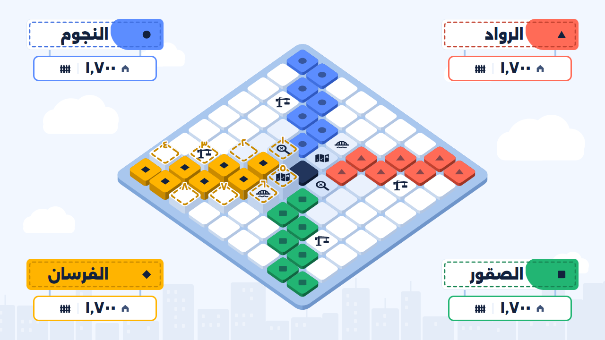
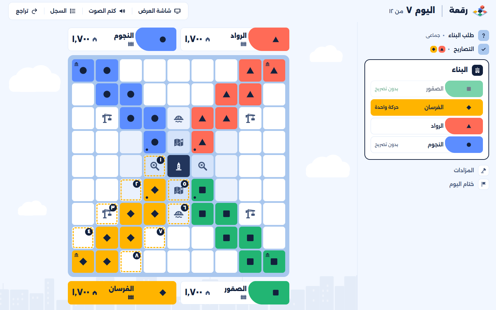
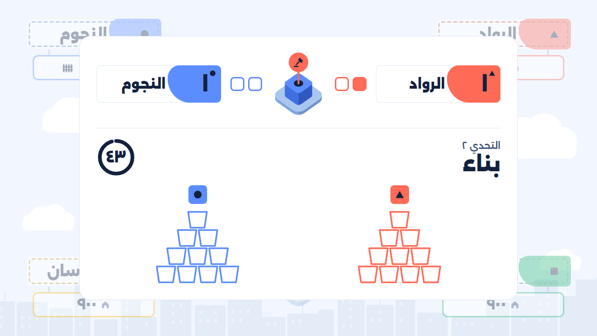
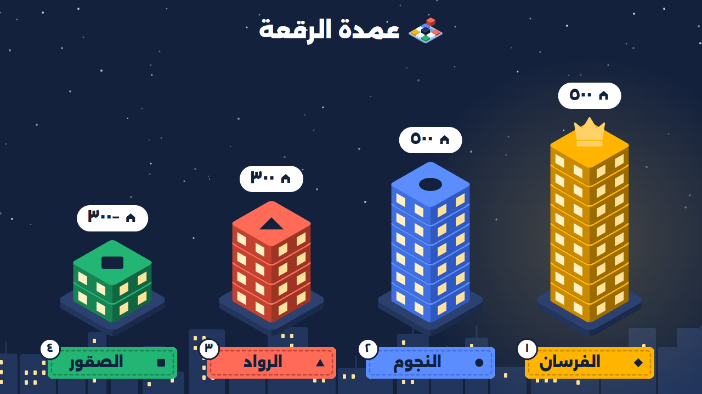

<p align="center">
  
</p>

<p align="center"><b>ابنِ مدينتك وتصدّر الرقعة</b></p>

# رقعة

«رقعة» مسابقة استحواذ حضورية. أربعة أحياء تبني على خريطة بالإجابات الصحيحة، وتتنافس على الأرض في المزادات، والفائز «عمدة الرقعة».

هذا المستودع فيه النظام الذي يدير المسابقة: **شاشة الحكم** على اللابتوب، يُدخل منها كل شيء ويطبّق النظام القوانين ويحسب، و**شاشة العرض** على التلفزيون، يراها الجميع ولا يُتحكّم فيها.

<p align="center">
  
</p>

---

## المسابقة في دقيقة

- أربعة أحياء، لكل حي لون ورمز وبلدية في زاوية من الخريطة: **المرجاني** مثلث، و**الأزرق** دائرة، و**الأخضر** مربع، و**الذهبي** معيّن.
- كل يوم: سؤال، ثم الأحياء التي أجابت إجابة صحيحة تأخذ **تصريح بناء**، ثم تبني قطعة أو تزايد على أرض حي آخر.
- القطع القريبة من وسط الخريطة أغلى، و**برج الرقعة** في الوسط أغلاها.
- على الخريطة **بطاقات** تعطي قدرات خاصة لأول حي يبني عليها.
- لكل حي **مشاريع سرية** تُكشف في النهاية، تضيف إلى سكانه أو تخصم منها.
- الفائز صاحب أكثر **سكان** في النهاية: سكان أرضه مع نقاط مشاريعه.

---

## الخريطة

يختار المنظم حجم الخريطة: **٩×٩** للمسابقة الكاملة، أو **٧×٧** للوقت القصير. كل حي يبدأ ببلديته في زاوية، والقطعتان متجاورتان إذا اشتركتا في ضلع، أما القطري فلا يُحسب.

قيمة القطعة بقربها من الوسط:

| الحلقة | القيمة | عدد القطع في ٩×٩ | عدد القطع في ٧×٧ |
| --- | --- | --- | --- |
| برج الرقعة (الوسط) | ٥ | ١ | ١ |
| الحلقة الأولى | ٤ | ٨ | ٨ |
| الحلقة الثانية | ٣ | ١٦ | ١٦ |
| الحلقة الخارجية | ٢ | ٥٢ | ٢٠ |
| البلديات | ١ | ٤ | ٤ |

- **نقاط الحي** مجموع قيم قطعه، والبلدية منها. و**السكان** = النقاط × ١٠٠، والشاشتان تعرضان السكان دائماً.
- القطع التي تنقطع عن البلدية تبقى للحي، ويستطيع البناء منها.
- البطاقات مكشوفة على الخريطة من البداية، وموزعة بالتساوي: كل حي على البعد نفسه من البطاقات نفسها.

---

## الأحياء واللاعبون

- لكل حي في الإعداد: اسمه، وعدد لاعبيه، ومشاريعه السرية (من ١ إلى ٣).
- لكل لاعب رقم من ١ إلى عدد لاعبي حيه. في الأسئلة الفردية يجيب لاعب واحد من كل حي، والأرقام تدور فيأخذ كل لاعب دوره. وللمزادات دورة أرقام ثانية، واللاعب نفسه يلعب كل تحديات المزاد.
- **قائد الحي** يعلن قرارات حيه: أين يبني، وعلى ماذا يزايد، ومتى يستخدم بطاقة.

---

## يوم البناء

المسابقة أيام متتالية، وكل يوم يمر بهذه الخطوات:

1. **طلب البناء:** الحكم يختار نوع السؤال.
   - **فردي:** تظهر أولاً أرقام اللاعبين (لاعب واحد من كل حي)، ثم السؤال بلا مؤقت، و**التصريح لأسرع إجابة صحيحة فقط**.
   - **جماعي:** يظهر السؤال مع مؤقت ٢٠ ثانية، و**كل حي أجاب إجابة صحيحة يأخذ تصريحاً**.
2. **التصاريح:** الحكم يعرض الإجابة، ويحدد الأحياء التي أجابت إجابة صحيحة.
3. **ترتيب البناء:** الأقل سكاناً أولاً، ثم الأقل قطعاً، ثم ترتيب ثابت يدور كل يوم.
4. **البناء:** كل حي معه تصريح يتحرك في دوره حركة واحدة، ولا بد أن يتحرك:
   - **بناء** على قطعة فارغة ملاصقة لأرضه، أو
   - **بناء بالجسر**، أو
   - **إعلان مزاد** على قطعة لحي آخر.

   القطع المتاحة للحي مرقمة على التلفزيون، فيذكر القائد رقم القطعة، والحكم يضغطها.
5. **المزادات:** تُلعب مزادات اليوم واحداً بعد الآخر، بترتيب إعلانها.
6. **ختام اليوم:** يتحدث السكان، ويبدأ اليوم التالي.

الحي الذي ليس معه تصريح يمر عليه الدور، إلا إذا كانت معه رافعة.

<p align="center">
  
</p>

---

## المزاد

المزاد **الطريقة الوحيدة لأخذ قطعة من حي آخر**. إعلانه يستهلك حركة الحي المزايد.

**القطعة التي يُزايَد عليها:** لحي آخر، وملاصقة لأرض المزايد، وليست بلدية، ولم تُبنَ ولم يتغير مالكها اليوم أو أمس، ولا مزاد معلن عليها اليوم.

- إذا كان مع صاحب الأرض **سياج** ولم يستخدم بطاقة اليوم، يستطيع إلغاء المزاد لحظة إعلانه، ويخسر المزايد حركته.
- يلعب الطرفان **تحديات**، والفائز **أول من يفوز بتحديين** (٣ تحديات على الأكثر). إذا تعادلا في تحدٍّ يُعاد بمحتوى جديد من النوع نفسه.
- **إذا فاز المزايد** صارت القطعة له. **وإذا فاز صاحب الأرض** بقيت قطعته، وخسر المزايد حركته.

نوع كل تحدٍّ يُختار عشوائياً من ستة أنواع، ومحتواه يظهر على التلفزيون:

| التحدي | الفكرة | الفائز |
| --- | --- | --- |
| حساب ذهني | عدد، ثم من ٣ إلى ٥ عمليات تظهر واحدة كل ٣ ثوانٍ | أول إجابة صحيحة |
| تهجئة | الحكم يقرأ كلمة بصوته، والطرفان يكتبانها | الكتابة الصحيحة |
| ذاكرة | ٨ صور أو ٨ كلمات تظهر ٢٠ ثانية ثم تختفي | أكثر عناصر صحيحة |
| ترتيب | كلمات جملة مبعثرة | أول ترتيب صحيح |
| دقة | ٣ محاولات لكل لاعب في مهمة تصويب يجهزها المنظم | أكثر إصابات |
| بناء | كل طرف يبني برجاً من الأكواب في ٤٥ ثانية | البرج الأطول |

مدة كل تحدٍّ ٤٥ ثانية، والذاكرة ٢٠ ثانية، والدقة بدون وقت. وإذا ما أجاب أحد إجابة صحيحة، «عرض الإجابة» يعرضها على التلفزيون، ثم «تعادل» يعيد التحدي بمحتوى جديد.

<p align="center">
  
</p>

---

## بطاقات الأكشن

البطاقة يأخذها **أول حي يبني على قطعتها**، بالبناء العادي أو بالجسر. أخذ القطعة بالمزاد لا يعطي بطاقة.

يستخدم الحي **بطاقة واحدة على الأكثر في اليوم**، وكل بطاقة تُستخدم مرة واحدة. ويستطيع استخدام البطاقة في اليوم نفسه الذي أخذها فيه.

| البطاقة | العدد | متى | ماذا تفعل |
| --- | --- | --- | --- |
| السياج | ٤ | لحظة إعلان مزاد على الحي | يلغي المزاد، ويخسر المزايد حركته |
| الرافعة | ٤ | في دور الحي | حركة إضافية في هذا اليوم، حتى لو أخطأ الحي |
| الجسر | ٢ | في دور الحي | يبني على قطعة فارغة لا تلاصق أرضه، على بعد قطعتين من قطعة له في الصف نفسه أو العمود نفسه. يستهلك حركة |
| المخطط السري | ٢ | فور أخذه | يوضع على قطعتين من أرض الحي غير البلدية، ويبقى طوال المسابقة مخفياً عن التلفزيون حتى يشتغل |
| مفتش البلدية | ٢ | فور أخذه | الحكم يختار حياً، وشاشته تعرض مشاريع ذلك الحي لقائد الحي الذي أخذ المفتش |

**المخطط السري:** كلما خسر مزايدٌ مزاداً على إحدى القطعتين، يأخذ صاحب المخطط قطعة من أرض المزايد ملاصقة لها، ليست بلدية. وإذا فاز المزايد بإحدى القطعتين، يزول المخطط عنها ويبقى على الأخرى.

وضع المخطط واستخدام المفتش لا يُحسبان بطاقة اليوم.

---

## المشاريع السرية

قبل اليوم الأول يكتب كل حي من ١ إلى ٣ مشاريع ويسلّمها للحكم، ويستطيع أكثر من حي اختيار المشروع نفسه. يحسبها النظام آلياً، ولا تُكشف إلا في الإعلان.

| المستوى | نجاح | فشل | المشاريع |
| --- | --- | --- | --- |
| سهل | +٤٠٠ | −٢٠٠ | **شارع داخلي:** ٤ قطع متتالية في صف أو عمود، كلها بعيدة عن حافة الخريطة · **مربع سكني:** ٤ قطع على شكل مربع ٢×٢ ليس فيها البلدية · **جامع البطاقات:** خذ بطاقتين من الخريطة |
| متوسط | +٨٠٠ | −٤٠٠ | **يد في كل حلقة:** قطعة في الحلقة الأولى، وقطعة في الثانية، وقطعة في الخارجية · **من حيين:** خذ قطعة من حيين مختلفين، بمزاد أو بمخطط سري · **مزايد ناجح:** اكسب مزادين وأنت المزايد |
| صعب | +١٬٢٠٠ | −٦٠٠ | **برج الرقعة:** امتلك برج الرقعة · **قلب المدينة:** ٣ قطع من الحلقة الأولى · **جار الجميع:** أرضك تلاصق أرض الأحياء الثلاثة |

---

## النهاية والفوز

- المنظم يحدد عدد الأيام، و**في آخر ٣ أيام يختفي السكان** عن التلفزيون، وتبقى الخريطة.
- في نهاية آخر يوم، أو إذا امتلأت الخريطة، يختار الحكم: **تمديد** بأيام يحددها، أو **الإعلان**.
- **النتيجة = سكان الخريطة + نقاط المشاريع.** المشروع الناجح يضيف والفاشل يخصم، وقد تنزل النتيجة تحت الصفر.
- عند التعادل: الأكثر قطعاً، ثم الأكثر حركات طوال المسابقة. وإذا بقي التعادل يتشاركون المركز.

**الإعلان** في الليل على التلفزيون، والحكم يتقدم فيه بزر «التالي»:

1. سكان الخريطة لكل حي.
2. المشاريع السرية واحداً بعد الآخر، ونتيجة كل مشروع.
3. منصة **«عمدة الرقعة»**: أربعة أبراج بترتيب الأحياء، والتاج للأول.

<p align="center">
  
</p>

---

## تشغيل المسابقة

- **ما تحتاجه:** لابتوب بنظام Windows عليه Chrome أو Edge، وتلفزيون موصول به بكابل HDMI.
- **التطبيق:** افتح الموقع وثبّته من أيقونة التثبيت في شريط العنوان، فيعمل بعدها بلا إنترنت. والنسخة الاحتياطية ملف واحد `raqaa.html` يُفتح بالنقر المزدوج ويعمل بلا إنترنت.
- **الإعداد:** «إنشاء غرفة»، ثم أسماء الأحياء وعدد لاعبيها ومشاريعها، وحجم الخريطة وعدد الأيام، وملف الأسئلة (Excel أو CSV بعمودين: السؤال والإجابة، وفي الصفحة «تنزيل القالب»).
- **الشاشتان:** اضغط Win + P واختر «توسيع»، ثم «فتح شاشة العرض» فتُفتح على التلفزيون، ثم اضغط عليها مرة لتملأ الشاشة ويعمل الصوت.
- **أثناء المسابقة:** «تراجع» يلغي آخر خطوة، و«السجل» يعرض كل ما حدث. المسابقة تُحفظ بعد كل خطوة، فإذا أُغلق المتصفح أو انطفأ اللابتوب تعود إلى اللحظة نفسها.
- **للتجربة:** «مسابقة تجريبية» في الصفحة الأولى تلعب مسابقة كاملة وحدها على الشاشتين.
- **دليل الحكم كاملاً:** [docs/GUIDE.md](docs/GUIDE.md)

الأسئلة لا تُنشر مع النظام: تبقى في ملف الحكم.

---

## للمطورين

موقع يُثبَّت كتطبيق ويعمل بلا إنترنت، ونسخة في ملف واحد، مبنيان من الكود نفسه بـ Vite وReact وTypeScript. القوانين دوال صافية في `src/engine`، وحالة المسابقة تُحسب من أحداثها، فالتراجع حذف آخر حدث.

```bash
pnpm install   # المكتبات
pnpm dev       # التطوير
pnpm test      # اختبارات القوانين والمنطق (Vitest)
pnpm e2e       # البناء ثم اختبارات المتصفح على Chrome وEdge (Playwright)
pnpm build     # الموقع في dist/ والملف الواحد dist/raqaa.html
```

| المجلد | ما فيه |
| --- | --- |
| `src/engine` | القوانين والحسابات، بلا واجهة |
| `src/referee` | شاشة الحكم |
| `src/landing` | الصفحة الأولى التي تشرح المسابقة |
| `src/display` | شاشة العرض وحركتها وأصواتها |
| `src/state` | الحفظ وربط النافذتين |
| `tests`، `e2e` | الاختبارات |
| `docs` | [القرارات](docs/decisions.md)، و[معايير القبول](docs/acceptance.md)، و[دليل الحكم](docs/GUIDE.md) |

النشر على CranL: كل رفع إلى `main` يبني `Dockerfile`، والاختبارات تمر أولاً، ولا يُنشر شيء إذا فشل اختبار.
